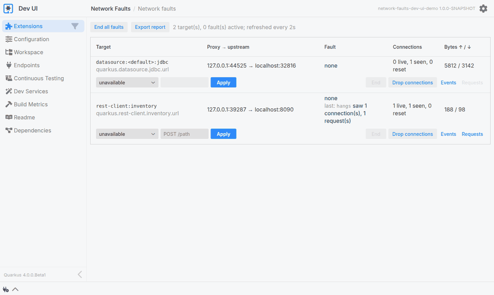

# Quarkus Network Faults

[](https://central.sonatype.com/artifact/io.quarkiverse.networkfaults/quarkus-network-faults)

**Make a dependency fail on purpose, inside your `@QuarkusTest`.**

Every outbound connection your application configures gets an in-process proxy in front of it.
A test applies a fault to that proxy, and the real client library, the REST Client, the JDBC
pool, the Redis or Kafka client, fails the way it fails in production: refused, hung, slow,
reset mid-response, answered with a 503. No Docker, no sidecar, no second environment. The
resilience of a service is tested where it lives, in its own test suite.

## The test

```java
@QuarkusTest
@TestProfile(NetworkFaultsProfile.class)
class OrderResourceTest {

    @Inject
    NetworkFaults faults;

    @Test
    void inventoryServiceHangs() {
        try (var ignored = faults.target(InventoryClient.class).hangs()) {
            // the @Timeout fallback answers
            when()
                    .post("/orders")
                    .then()
                    .statusCode(503);
        }

        // the fault is over and the circuit breaker was reset: the next order goes through
        when()
                .post("/orders")
                .then()
                .statusCode(201);
    }
}
```

That is the whole test. The target is the bean the application already injects, the fault is
one method call, and the try-with-resources block is the window during which the dependency
is broken. When the block ends the proxy relays again, connection pools are flushed and circuit
breakers are reset, so the recovery can be asserted in the same test.

One test dependency brings everything in:

```xml
<dependency>
    <groupId>io.quarkiverse.networkfaults</groupId>
    <artifactId>quarkus-network-faults-junit</artifactId>
    <version>${quarkus-network-faults.version}</version>
    <scope>test</scope>
</dependency>
```

Support for each kind of dependency is picked up from the extensions already in the
application; there is nothing else to add.

### More scenarios, same shape

A transient failure the `@Retry` absorbs: the first two calls get a 503, the third reaches the
service.

```java
try (var ignored = faults.target(InventoryClient.class).http().forFirst(2).http().respondsWith(503)) {
    when()
            .post("/orders/retrying")
            .then()
            .statusCode(201);
}
```

A streamed response cut after the third Server-Sent Event: the service relays three events,
then ends its own stream cleanly instead of cutting the caller's.

```java
try (var ignored = faults.target(InventoryClient.class).diesMidRequest(Moment.Http.afterSseEvents(3))) {
    when()
            .get("/orders/stock-updates")
            .then()
            .statusCode(200)
            .body(containsString("stock level 4"))
            .body(containsString("stream ended early"))
            .body(not(containsString("stock level 3")));
}
```

A database that stops answering: the request fails on the pool's timeout and the caller gets a
503, not a stack trace.

```java
try (var ignored = faults.target(DataSource.class).hangs()) {
    when()
            .get("/orders")
            .then()
            .statusCode(503);
}
```

A test that applies a fault no request went through fails, with a message naming the
configuration property to look at. A fault test cannot pass by accident.

## See it before you test it

In dev mode the **Network faults** card in the Dev UI lists every target of the running
application and lets you break them by hand.



- **Every fault, on any target**, or only on the requests a `POST /path` scope selects. A
  `responds-with:503` can carry a body and a content type.
- **Requests**: every HTTP request a target sent, with its headers, body fingerprint, status
  and response time, so a retry storm or an open circuit breaker is visible at a glance.
- **The verdict on the last fault** of every target: whether any traffic went through it while
  it was active, which is the guard's verdict in dev mode, so a fault on the wrong target shows.
- **Report**: the whole session as Markdown, to paste into an issue or a pull request.

Try it on the sample application, which needs only Docker:

```bash
./mvnw -f samples/dev-ui-demo/pom.xml quarkus:dev
```

## Let an agent write the tests

The dependency failure tests a service needs are predictable: one per guarded method, one per
failure mode. That is work an AI agent can do, if it knows how. The extension gives it what it
needs.

With `quarkus.dev-mcp.enabled=true`, the Dev UI card becomes a set of **Dev MCP tools** on the
running application, with descriptions written for an agent. Point your agent at
`http://localhost:8080/q/dev-mcp`; with Claude Code:

```bash
claude mcp add --transport http network-faults http://localhost:8080/q/dev-mcp
```

Three resources come with the tools:

- **The test-writing guide**: the one document an agent needs to write a test with this
  extension. It is the same text on the documentation site, for an agent working in a repository
  without the application running.
- **The inventory**: every method of the application guarded by a Fault Tolerance annotation,
  with the effective values, and the injected types a test can pass to `target(...)`. It turns
  "write resilience tests for this service" into a list.
- **The playbook**: safety rules and an experiment loop. Form a hypothesis, apply the fault,
  call the endpoint, read what happened, and then write the test that pins it.

A prompt that uses all three:

> Read the quarkus-network-faults test-writing guide and the inventory, then write the
> `@QuarkusTest`s that verify what `/orders` does when the inventory service hangs, fails, or
> dies mid-response. Run the experiments first if you are unsure what to assert.

The tools that apply faults are opt-in, enabled from the Dev UI, so an agent cannot break a
running application until you say so. The extension generates no test code: the agent writes
it, from what it read and what it observed. See
[AI Agents](https://docs.quarkiverse.io/quarkus-network-faults/dev/agents.html).

## Why it works

- **Nothing to start.** The proxy is a Vert.x server inside the test JVM. Dev Services work
  unchanged, and so does every client library, because nothing about it is mocked.
- **Targets are the beans you inject.** `faults.target(InventoryClient.class)`,
  `faults.target(DataSource.class)`, with the same qualifiers the application uses.
- **Faults the network really produces.** Refused connections, connect timeouts, hangs, latency,
  resets and clean closes at a chosen moment of the response, and HTTP error statuses. A fault
  can strike the first n requests, every nth, or one method of a client, deterministically.
- **Consequences are undone.** When a fault ends, and after every test, Agroal pools are
  flushed and SmallRye Fault Tolerance circuit breakers are reset.

## What it covers

Targets are discovered from the application's configuration, Dev Services included, and a test
addresses one by the bean the application injects.

| Dependency | How a test addresses it |
|---|---|
| JDBC datasource | `target(DataSource.class)`, a named one with its `@DataSource` literal |
| Reactive datasource | `target(Pool.class)` |
| Hibernate ORM, Hibernate Reactive, Quarkus Data, Jakarta Data | `target(EntityManager.class)`, `target(Mutiny.SessionFactory.class)` or the repository type, resolved to the datasource behind it |
| REST Client | `target(InventoryClient.class)`, the interface; `target(InventoryClient::reserve)` for one method's requests |
| Redis | `target(RedisDataSource.class)`, or the Vert.x clients; standalone mode |
| MongoDB | `target(MongoClient.class)` or the reactive client; standalone servers |
| SmallRye GraphQL client | the typesafe interface, or a dynamic client by name |
| gRPC client | `target(Greeter.class, GrpcClient.Literal.of("greeter"))` |
| Kafka | the emitter or client bean; bootstrap connection only, see below |
| Quarkus LangChain4j | `target(ChatModel.class, ModelName.Literal.of("name"))` or the AI service; chat memory and embedding stores through the client behind them, Chroma by URL; MCP servers with `target(McpClient.class, McpClientName.Literal.of("name"))` |

The faults: `unavailable`, `connectTimeout`, `hangs`, `slow`, `diesMidRequest`, `closes`,
`dropConnections`, `http().respondsWith(status)` with a body and headers, and latency with
jitter, bandwidth and slicing under `advanced()`. `diesMidRequest`, `closes` and `hangs` take a
moment: the client's next write, or in the response after n bytes, after the headers, after n
chunks or after n Server-Sent Events. `http().forFirst(n)`, `every(n)` and `after(n)` select
some of the requests, and `traffic()` counts and lists what went through, so a test can check
that every retry carried the same idempotency key.

Read the [documentation](https://docs.quarkiverse.io/quarkus-network-faults/dev/index.html) for
the quick start, the guides, and the reference pages for faults, targets, the guard and the
client timeout defaults these tests tend to surface.

## Requirements

- Quarkus `4.0.0.Beta1` or later
- Java 21 or later

## Known limitations

- Kafka: only the bootstrap connection is proxied; the client reconnects to the broker's
  advertised address. Redis in cluster or sentinel mode and MongoDB replica sets bypass the
  proxy the same way; standalone servers are fine.
- `connectTimeout()` is Linux only.
- TLS passes through but certificates must accept `127.0.0.1`; request counting and the HTTP
  faults need plaintext HTTP/1.x.
- No `@QuarkusIntegrationTest` support.
- Faults that fire at random or on a clock were left out on purpose: a test that fails one run
  in twenty is worse than no test. `forFirst`, `every` and `after` give the same scenarios a
  deterministic shape.

## Build

`./mvnw install`. Tests need Docker for Dev Services.
